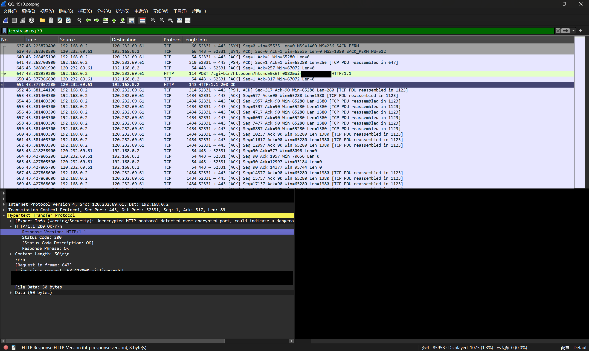
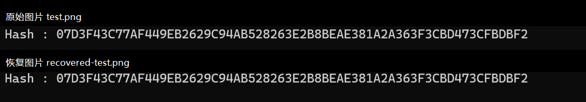

[README.md](https://github.com/user-attachments/files/33627293/README.md)
# 使用 Wireshark 分析 QQ 文件传输：PC → 手机实验

实验日期：2026 年 10 月 18 日

## 一、实验目的

通过抓取本人 QQ 测试账号之间的通信，分析文件传输采用 TCP 还是 UDP、内容是否明文可见，以及能否从抓包中恢复文件。

本次仅完成 **PC → 手机** 场景。受设备条件限制，**PC → PC 尚未完成**，本文不将其列为已验证结果。

## 二、实验环境与操作

- 发送端：Windows 11 电脑，QQ 客户端；本机核对版本为 9.9.20.36330。
- 接收端：手机 QQ，登录本人另一个账号。
- 抓包工具：Wireshark 4.6.9，抓取电脑 WLAN 网卡。
- 测试内容：标记文字 `QQ_TEST_20261018_ABC123`、`test.png` 和 `test.txt`。
- 原图片大小：1,071,303 字节；原文本大小：1 字节。
- 19:10 在电脑发送，19:13 在手机接收。
- 抓包实际覆盖 19:10:05.911842—19:13:38.029041，共 85,958 个数据包。

先开始抓包，再通过 QQ 发送测试消息和文件，待手机接收后停止抓包。分析时仅关注与实验相关的流；抓包中其他应用的流量不作为 QQ 的协议证据。

## 三、定位文件传输连接

在 Wireshark 的显示过滤器中输入：

```wireshark
tcp.stream == 79
```

该流中能看到 TCP 三次握手、HTTP POST 请求及 HTTP/1.1 200 OK 响应。远端端口为 443，但其应用层数据可直接解析为 HTTP，而不是根据端口号推断出的 HTTPS。



进一步筛选请求：

```wireshark
tcp.stream == 79 && http.request
```

请求路径为 `/cgi-bin/httpconn`。原请求查询参数中含账号标识，公开截图已经遮挡。PNG 文件头位于数据包 653，时间约为 19:10:49.293245；TXT 内容在约 19:11:05.334549 上传。

## 四、TCP 还是 UDP？明文还是加密？

**本次两个测试文件的电脑上传连接使用 TCP，文件内容明文可恢复。**

判断依据不是“443 端口”，而是实际捕获到的 HTTP 请求，以及从 TCP 重组数据中提取出的完整原始文件。文件数据带有应用层封装，但封装本身并不等于加密。

测试聊天文字未以完整原始字节串出现在抓包中。仅凭“搜索不到文字”不足以判断加密，因此本文不对聊天消息是否加密或具体加密算法作确定结论。

## 五、恢复文件的方法

1. 对 TCP 流 79 进行重组，区分电脑上传与服务器响应两个方向。
2. 按 HTTP 头中的 `Content-Length` 拆出各 POST 请求体。
3. 本次请求体以 `0x28` 开始、`0x29` 结束，中间包含元数据与文件内容。起始字节之后的两个大端 32 位长度分别对应元数据长度、文件数据长度；根据这些长度去掉封装。
4. 图片的三块文件数据长度分别为 524,288、524,288、22,727 字节。按上传顺序拼接，得到 1,071,303 字节的 PNG。
5. 检查 PNG 签名 `89 50 4E 47 0D 0A 1A 0A`、PNG 数据块 CRC 和末尾 IEND。本次 22 个数据块的 CRC 检查均通过。
6. 提取同一连接中的 1 字节 TXT 文件，并分别与原文件比较。

这些封装字段是本次抓包中的观察结果，不保证其他 QQ 版本或传输模式完全相同。不能将整个 TCP 流直接改扩展名为 PNG，因为流中还包含 HTTP 头和应用封装。

## 六、哈希验证

恢复文件与原文件逐字节比较一致，SHA-256 也一致。

| 文件 | 原文件 SHA-256 | 恢复文件结果 |
|---|---|---|
| test.png | `07d3f43c77af449eb2629c94ab528263e2b8beae381a2a363f3cbd473cfbdbf2` | 相同，1,071,303 字节 |
| test.txt | `8e35c2cd3bf6641bdb0e2050b76932cbb2e6034a0ddacc1d9bea82a6ba57f7cf` | 相同，1 字节 |

以下是图片原文件与恢复文件的 PowerShell 哈希对比截图，路径行已遮挡：



Windows 下可使用以下命令自行复核，路径替换为实际文件位置：

```powershell
Get-FileHash -Algorithm SHA256 -LiteralPath "原文件路径", "恢复文件路径" | Format-List Path,Hash
```

## 七、结论与限制

- 本次 PC → 手机实验中，已确认电脑上传测试文件使用 TCP，应用层为明文 HTTP。
- 目标端口是 443，并不自动代表使用了 TLS 加密。
- 已从抓包恢复 PNG 与 TXT，两者均与原文件一致。
- 抓包位置在发送电脑，验证的是 **PC 上传这一段**。手机 19:13 下载时的手机与服务器通信未直接抓取，不能由此断言手机接收链路同样明文。
- 尚未完成 PC → PC；聊天消息是否加密也未得到充分证据。
- 结论仅适用于本次实际捕获的连接，不能推广为“所有 QQ 流量都明文”。

本文仅展示本人测试账号通信的脱敏证据，不公开含账号和其他网络活动的原始抓包。

## 参考

- [Wireshark 用户指南：导出数据](https://www.wireshark.org/docs/wsug_html_chunked/ChIOExportSection)
- [Wireshark 用户指南](https://www.wireshark.org/docs/wsug_html_chunked/)
